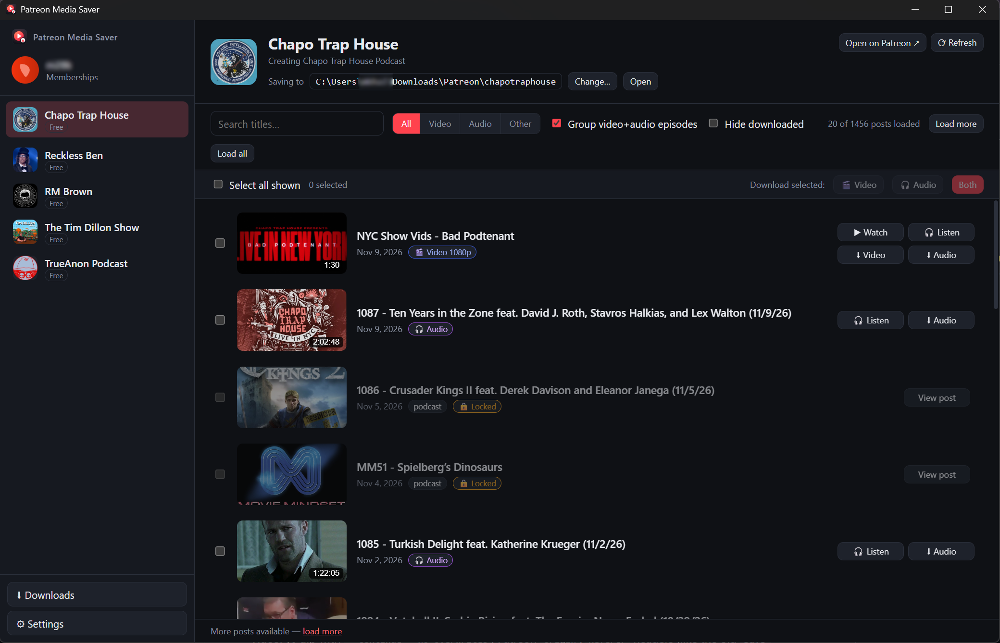

# Patreon Media Saver

**A friendly Windows desktop app for browsing your Patreon memberships, watching videos, listening to podcasts, and saving your own local copies.**

No command line, no browser extensions, and no complicated setup — just sign in, pick a creator, and click **Watch**, **Listen**, or **Download**.



---

## Download & Run

1. Go to the [**Releases**](https://github.com/moekhalil/patreon-media-saver/releases/latest) page.
2. Download `PatreonMediaSaver-x.x.x-portable.exe`.
3. Put it in any folder you like and double-click it to launch. Nothing needs to be installed.

> **Note:** Because the app isn't code-signed, Windows SmartScreen may show a *"Windows protected your PC"* popup the first time you open it. Click **More info → Run anyway**.

On first launch, the app automatically downloads the free helper tools it needs for video and audio into a folder next to the app.

---

## What You Can Do

### 📺 Watch Videos & Listen to Audio In-App
- **Watch Video Posts:** Click any video post to open the built-in video player and watch right inside the app.
- **Listen to Podcast / Audio Posts:** Click any audio episode to play it in the persistent bottom audio player while you keep browsing.
- **Combined Episodes:** When creators post a video version and an audio version of the same episode separately, the app automatically groups them into a single clean row so your feed isn't cluttered.

### ⬇ Download Video & Audio Files
- **Download Videos (`.mp4`):** Save videos in the best available quality (or cap them at 1080p, 720p, etc. in Settings).
- **Download Audio (`.mp3`):** Save podcast episodes directly as standard `.mp3` files for your phone, car, or media server.
- **Audio-from-Video Fallback:** If a creator only uploaded a video for an episode, the app can automatically extract an `.mp3` audio file from the video for you.
- **Batch Downloading:** Select multiple episodes (or click **Select all shown**) and download **Video**, **Audio**, or **Both** at once.
- **Smart Duplicate Detection:** Posts you've already saved are marked with a **✓** so you always know what you have and never re-download by accident.

### 💬 Automatic Subtitles
- **Built-in Soft Subtitles:** Whenever a Patreon video includes a transcript, the app automatically attaches it inside the `.mp4` file as a subtitle track. You can toggle captions on or off in VLC, Plex, Jellyfin, or any modern media player.
- **Separate `.vtt` Files (Optional):** If you also want a standalone `.vtt` subtitle file saved next to your video, you can enable that in Settings.
- **Add Subtitles to Existing Videos:** Clicking a video you already downloaded will check if it's missing subtitles and attach them without re-downloading the video.

### 📁 Flexible Folder Organization (Global or Per-Podcast)
You have full control over where your files go:
- **Global Download Folder:** Set one main folder in **⚙ Settings** (defaults to `Downloads\Patreon`), with an option to automatically create a subfolder for each creator (e.g. `F:\PODCASTS\chapotraphouse`).
- **Per-Creator / Per-Podcast Custom Folder:** Want a specific podcast or creator saved to a completely different drive or folder? Click **Change…** next to *"Saving to"* at the top of that creator's page to give them their own dedicated folder.
- **Custom File Names:** Customize how saved files are named using `{title}`, `{date}`, `{campaign}`, `{id}`, and `{type}`, plus optionally save episode thumbnail images alongside your media.

---

## How to Use It

1. **Sign in:** Click **Log in with Patreon** and sign in through the pop-up window. Your login stays saved locally on your PC.
2. **Choose a creator:** Pick any creator you support from the sidebar on the left.
3. **Set your folder (optional):** Use the default folder shown at the top, or click **Change…** to pick a specific folder for that podcast/creator.
4. **Watch, Listen, or Save:** Click **▶ Watch** or **🎧 Listen** to play in the app, or click **⬇ Video** / **⬇ Audio** on any episode (or select several at once) to save them to your computer.

---

## FAQ

- **Does this bypass paywalls?**
  No. It uses your own Patreon account and can only access posts from memberships you actively have access to.
- **Where are my downloaded files saved by default?**
  Inside `Downloads\Patreon\<creator-name>`, unless you change your global folder in **⚙ Settings** or set a custom folder on a creator's page.
- **Does it work on Mac or Linux?**
  It's built and packaged for Windows right now.

---

## Please Support Creators ❤️

This app is intended for personal archiving and offline listening/viewing of memberships you pay for. Please respect creators and do not redistribute or re-upload their work.

---

<details>
<summary>For developers (building from source)</summary>

```powershell
npm install
node node_modules\electron\install.js   # only needed if electron.exe is missing after install
npm start                               # run the app in development mode
npm run dist                            # build the portable Windows .exe into dist\
npm run icons                           # regenerate icons after editing src/assets/icon.svg
```

- Built with Electron. `yt-dlp` and `ffmpeg` are downloaded automatically into `third-party\` (next to the `.exe` in portable builds, or in the repo root during development).
- User settings are saved in `%APPDATA%\Patreon Media Saver\settings.json`.
- Pushing a `v*` git tag triggers GitHub Actions to build and publish a new GitHub Release automatically.

</details>
